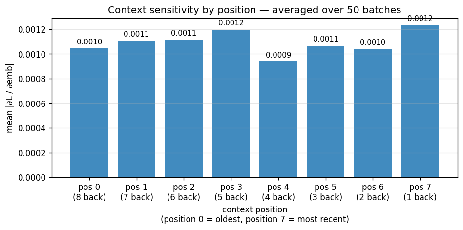
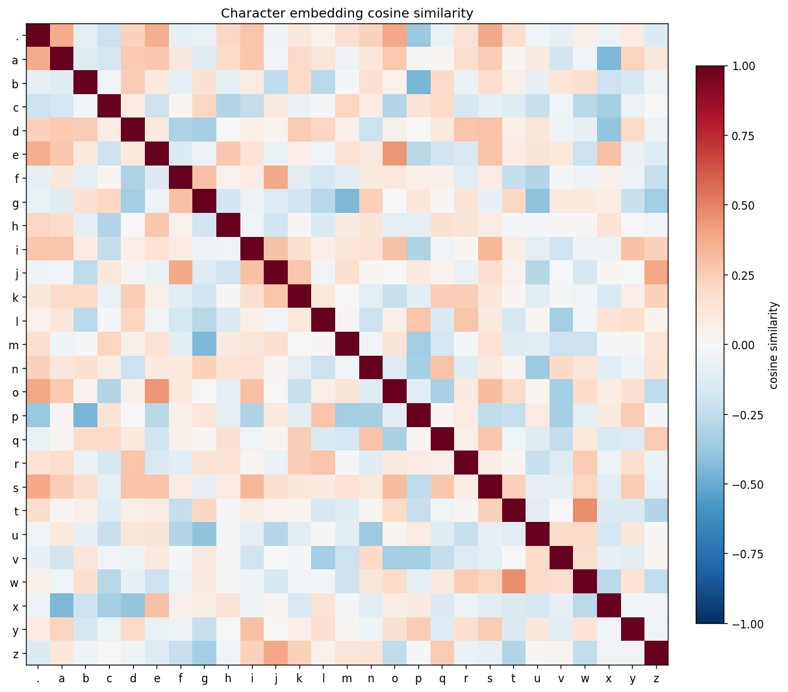

# makemore


Five character-level language models trained on 32K first names, from a count-based bigram to a hierarchical WaveNet, followed by an analysis of what the trained WaveNet learned.

The models follow Karpathy's [makemore](https://github.com/karpathy/makemore) series. This is the second repo in a series: [micrograd](https://github.com/diego-magana/micrograd), this one, then [gpt](https://github.com/diego-magana/gpt).

## Models

| Model | What it adds | Val NLL | Steps |
|---|---|---:|---|
| Count bigram | Baseline with Laplace smoothing | 2.4544 | closed form |
| Neural bigram | The same model fit by gradient descent | 2.4623 | 200 |
| MLP (Bengio 2003) | Learned embeddings, context window | 2.2957 | 30K |
| MLP + Kaiming + BatchNorm | Stable activations, modular layers | 2.1750 | 30K |
| Hierarchical WaveNet | 8-character receptive field | 2.0128 | 50K |

The two bigrams are the same model class fit two ways, so they reach about the same loss. Karpathy's reference WaveNet reaches about 1.99 at roughly 200K steps. I stopped at 50K because the goal here is the implementation and the analysis, not the benchmark.

`notebooks/progression/04_backprop_ninja.ipynb` retrains the MLP + BatchNorm model with handwritten gradients and no `loss.backward()`. Each gradient is checked against autograd. The result is a dev NLL of 2.1739, within about 0.001 of the autograd version.

## What the WaveNet learned

The analysis is in [`notebooks/06_probing.ipynb`](notebooks/06_probing.ipynb). The model has 76,579 parameters and three levels that see 2, 4 and 8 characters.

### Recent characters matter most, and gradients miss it

Gradient magnitude with respect to each input position is nearly flat across all 8 positions (most recent to oldest ratio of 1.18x). That suggests the model uses the whole context evenly.

Ablation says otherwise. Replacing a position's embedding with the dataset mean raises dev NLL by about 0.8 nats for the most recent character and about 0.003 for the oldest, with a steady decline in between. A permutation ablation gives the same shape.

The gradient measure was wrong here and the intervention was right. This is why the [gpt](https://github.com/diego-magana/gpt) repo relies on ablation and patching.



### Embeddings separate vowels from consonants

Mean cosine similarity between vowel embeddings is +0.18. Between consonants it is about zero (-0.002). The boundary token `.` sits closest to the vowels (+0.27), which matches how often names start and end with a vowel. I did not find finer structure among consonants. PCA on the 24-dimensional embeddings captures only 22% of the variance, so a 2D projection may be hiding some.



### Single neurons matter most at the top level

I zeroed the five highest-activation neurons at each level, one at a time. A single level-3 neuron can raise dev NLL by up to 0.027 nats. At levels 1 and 2 the effect rarely exceeds 0.006.

### Activations stay healthy at depth

The share of saturated tanh units (|activation| > 0.97) is 9.8%, 12.0% and 5.4% across the three levels, under the 15% threshold I used as a warning sign. Level 3 is bimodal, with mass just inside the saturation threshold.

### Limits

The ablations show which positions and neurons matter for prediction. They do not show what any neuron computes. The embedding and activation analyses are correlational. Answering the "what" question needs activation patching, which is easier on a transformer and is the subject of the gpt repo.

## Run it

```bash
pip install -r requirements.txt
pip install -e .
jupyter lab notebooks/    # progression/01 to 05 in order, then 06_probing
pytest
```

`assets/wavenet.pth` is committed so the probing notebook runs without the 50K-step training.

## Layout

```
makemore/
├── makemore/
│   ├── data.py       tokenization, dataset construction, splits
│   ├── layers.py     Linear, BatchNorm1d, Tanh, Embedding, FlattenConsecutive, Sequential
│   └── train.py      training loop, evaluation, sampling
├── models/
│   ├── bigram.py           CountBigram, NeuralBigram
│   ├── mlp.py              Bengio 2003 MLP, LR finder
│   ├── mlp_batchnorm.py    MLP + Kaiming + BatchNorm
│   └── wavenet.py          hierarchical WaveNet, checkpointing
├── notebooks/
│   ├── 06_probing.ipynb
│   └── progression/        01 bigram, 02 MLP, 03 BatchNorm, 04 manual backprop, 05 WaveNet
├── assets/                 figures, wavenet.pth
├── data/                   names.txt
└── tests/
```

## Implementation notes

- Every `Linear` followed by `BatchNorm1d` uses `bias=False`. BatchNorm subtracts the batch mean, which cancels the bias, and its own `β` takes over that role.
- The final layer's weights are scaled down (0.01 for the MLP, 0.1 for the WaveNet) so initial predictions are near uniform. The initial loss is then about `log(27) = 3.30` instead of about 27.
- `FlattenConsecutive(2)` is applied three times, so each level merges adjacent pairs from the level below. A single `FlattenConsecutive(8)` would make the first hidden layer learn all 8 positions at once.
- Gradients are reset with `p.grad = None`, not `p.grad.zero_()`. It makes no difference at this size and is the cheaper habit on large models.
- The layers do not use `nn.Module`, so BatchNorm's running buffers change shape after the first forward pass. `models/wavenet.py::load_checkpoint` handles this by assigning the saved buffers directly. `register_buffer()` would normally take care of it.

## Attribution

The architectures follow Andrej Karpathy's [makemore](https://github.com/karpathy/makemore) and his Zero to Hero videos. The package structure, the manual backprop verification and the probing analysis are mine.
